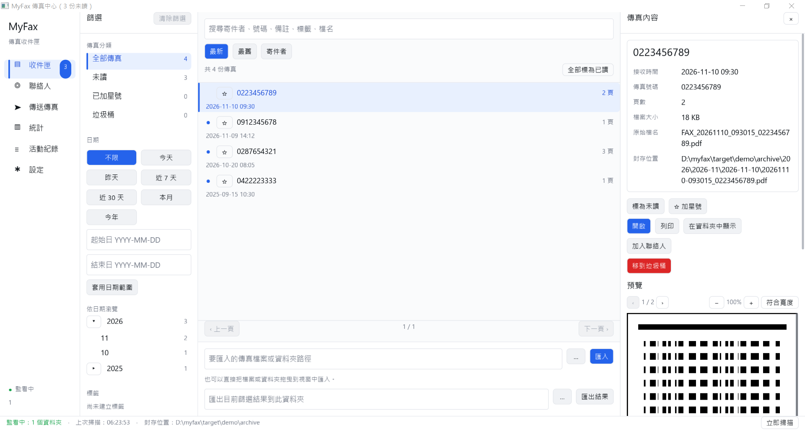

# MyFax

MyFax is a native Windows fax inbox. It replaces the receiving side of Epson FAX Utility.
Epson printers with fax can save received faxes as PDF (or TIFF) files to a shared network
folder. MyFax watches those folders, archives every fax by date, indexes it in a local SQLite
database, and shows the result in an inbox.

- MyFax does **not** talk to the printer directly and does **not** replace the Epson driver.
- Sending a fax uses the Epson FAX printer driver that is already installed. MyFax hands the
  document to that driver; the driver asks for the fax number.
- MyFax is not affiliated with Epson.
- Windows is the only platform that has been tested.



Other screenshots: [statistics](docs/screenshots/stats-zh-TW.png).

## Features

- **Watched folders**: polls folders on a configurable interval (default 5 s, 2 to 3600 s). A file
  is imported only after its size and modification time stay unchanged across two polls, it is
  at least 5 s old, and a PDF ends with its `%%EOF` trailer (TIFF: valid header); a file that never
  gets a trailer is still imported after 10 unchanged polls. A file the printer is still writing
  is therefore not imported early.
- **Date-organised archive**: every fax is copied to
  `<archive root>\YYYY\YYYY-MM\YYYY-MM-DD\YYYYMMDD-HHMMSS_<sender>.pdf`. Faxes without a sender
  number use `unknown` in the name.
- **Duplicate detection**: identical content (SHA-256) is recognised and not archived twice.
- **Filename parsing**: date, time and sender number are read from the file name, for example
  `FAX_20261110_103045_0912345678.pdf` gives 2026-11-10 10:30:45 from 0912345678. If no date is
  found, the file's modification time is used.
- **Inbox**: folders All, Unread, Starred and Trash; date presets (any time, today, yesterday,
  last 7 or 30 days, this month, this year, custom range); a year / month / day date tree; tag
  filter; sort by newest, oldest or sender; paging (10 to 500 items per page, default 50).
- **Search**: substring search over sender name, sender number, note, file name and tags.
- **Fax details**: sender name, tags and note are editable. Actions: mark read or unread, star,
  move to trash, restore, delete permanently (with confirmation), open, print, show in folder,
  add the sender to contacts.
- **Page preview**: PDF and TIFF pages with zoom (50% to 300%, fit-to-width) and page navigation.
  Unsupported files fall back to "open with the default app".
- **Export**: copy every fax that matches the current filter (all pages) to a chosen folder.
- **Drag and drop / import**: drop files or folders onto the window, or type a path in the inbox.
  Folders are imported from their top-level files only.
- **Contacts**: add, edit, search and delete contacts. Sender names come from contacts matched by
  fax number. CSV import and export (see below).
- **Send fax**: choose a fax printer, a file and an optional recipient; the history is kept.
- **Statistics**: totals, average per day, busiest day, daily and monthly bars, top senders over
  7, 30 or 365 days.
- **Activity log**: Info, Warning and Error entries, with a clear action (confirmed).
- **Auto-print**: optionally print each fax that arrives through a watched folder on the default
  printer.
- **Extra copy folder**: optionally copy every new fax to a second folder.
- **Trash retention**: trashed faxes older than the retention period (default 30 days, 0 = never)
  are purged at start-up.
- **Languages and themes**: Traditional Chinese (Taiwan, default) and English; light and dark theme.

## Requirements

- Windows (the only tested platform).
- Rust stable toolchain. `Cargo.toml` sets `rust-version = "1.88"` and uses edition 2024.
- Network access at build time: AcmeUI-Native is a git dependency pinned to a revision in
  `Cargo.toml`.
- For receiving: an Epson printer with fax that can save received faxes to a network folder
  (see [docs/EPSON_SETUP.md](docs/EPSON_SETUP.md)).
- For sending: the Epson FAX printer driver installed on the PC.

## Quick start

```powershell
cargo build --release
.\target\release\myfax.exe
```

The release binary is `target\release\myfax.exe`.

1. Open **Settings** (設定) and add the folder that the printer saves to under **Watch folders**
   (監看資料夾).
2. Press **Scan now** (立即掃描) in the status bar to test.
3. Open **Inbox** (收件匣) to see the faxes.

## Epson setup

Short version: on the printer, set **Fax Output** to **Save to Network Folder (SMB)**, point it at a
folder shared from this PC, choose **PDF**, and add the same folder to MyFax's watch folders.
Menu names differ by model and firmware. The full steps, in Traditional Chinese and English, are
in [docs/EPSON_SETUP.md](docs/EPSON_SETUP.md).

## Usage tour

- **Inbox**: the left column has folders, date presets, the date tree and tags. The middle
  column is the list (search box at the top, sort, paging, export). The right pane shows the
  selected fax: details, actions, the edit form and the preview. The window title shows the unread
  count.
- **Contacts**: list and search on the left, editor on the right. The CSV section at the bottom
  imports and exports contacts.
- **Send fax**: 1. choose a fax printer, 2. choose a file, 3. optionally enter a recipient and a
  note, then press **Send fax**. Printers whose names contain "fax" are marked and listed first.
  Press **Refresh** after installing a driver.
- **Statistics**: choose a range (7 days, 30 days, 1 year) to see totals, charts and top senders.
- **Activity log**: lists what MyFax did (imports, duplicates, prints, settings changes, errors).
- **Settings**: language, theme, watch folders, scan interval, archive folder, trash retention,
  page size, and switches for deleting source files, accepting TIFF, auto-print, banners and the
  extra copy folder.

### CSV format (contacts)

- Header: `name,company,fax,phone,email,note`, UTF-8, RFC 4180 quoting.
- Export writes a UTF-8 byte-order mark so spreadsheet programs show Chinese text correctly.
- Import accepts files with or without the BOM. A row whose fax number matches an existing
  contact updates that contact.
- Spreadsheet formula guard: on export, text values that start with `=`, `+`, `-` or `@` get a
  leading apostrophe. The apostrophe is removed on import.

## Keyboard tips

- **Enter** in most text fields runs the field's main action, for example search, import, add a
  watch folder, or save a contact.
- **Esc** in a text field leaves the field; pressed again (or with no field focused) it cancels the
  open confirmation dialog or the contact editor.
- **Tab** and **Shift+Tab** move focus between buttons, fields and clickable rows (fax list, folders,
  date tree, navigation). **Space** or **Enter** activates the focused button or row.
- **Shift + mouse wheel** pans the zoomed fax preview horizontally.
- Dialog and button labels follow the selected language.

## Data and backup

- Settings: `%APPDATA%\MyFax\settings.json`.
- Database: `%APPDATA%\MyFax\myfax.db` (SQLite in WAL mode; `myfax.db-wal` and `myfax.db-shm`
  may also exist while the app runs).
- Archived faxes: the archive folder, default `Documents\MyFax Archive`.
- Set the environment variable `MYFAX_DATA_DIR` to use another data folder (portable or test use).

To back up, close MyFax first, then copy `settings.json`, `myfax.db` (with any `-wal` and `-shm`
files) and the archive folder. The archive folder holds the actual fax files; the database holds
the index, tags, notes and contacts.

## Troubleshooting

| Symptom | Likely cause | What to do |
|---|---|---|
| "Folder not found" (找不到資料夾) message, or the status bar shows a watcher error | The watch folder path is wrong, or the share is not reachable | Open the path in File Explorer. Fix the path or the share, then press Scan now. |
| A fax was received but nothing appears | The folder is not in Watch folders; the file is not `.pdf` (or `.tif`/`.tiff` with TIFF off); the file is still being written or is 0 bytes | Check the watch folder list and the TIFF switch. Wait, then press Scan now. |
| A fax appears only once even though the printer sent it twice | Same content is detected as a duplicate and not archived again | This is expected. The activity log shows "Skipped duplicate fax". |
| Preview is unavailable | The PDF is encrypted, or it uses an unsupported encoding (for example JBIG2, JPEG 2000 or LZW), or a non-first TIFF page uses a non-CCITT compression | Press **Open** to view the file in the default app. |
| The fax driver is not in the printer list | The driver is not installed, or the list is stale | Install the Epson FAX driver, then press **Refresh** on the Send fax page. |
| TIFF faxes are not imported | "Also accept TIFF faxes" is off | Turn on the switch in Settings, then press Save settings if prompted. |
| Settings are not saved | A number or path field is invalid | Read the message under the field. Path and number fields need **Save settings**. |

## Build and test

CI (`.github/workflows/ci.yml`) runs on `windows-latest`:

```powershell
cargo fmt --all -- --check
cargo clippy --locked --all-targets -- -D warnings
cargo test --locked --all-targets
cargo test --locked --doc
cargo build --locked --release
```

The workflow uploads `target/release/myfax.exe` as the artifact `myfax-windows-x64`.

## Known limitations

- Windows is the only tested platform.
- MyFax is not affiliated with Epson.
- Only the watched folders are read. Faxes forwarded by e-mail are not fetched.
- Preview does not support JBIG2, JPEG 2000, LZW or encrypted PDFs. The app offers "open with the
  default app" instead. PDF images with CCITT two-dimensional (K greater than 0) encoding are not
  previewed either.
- For TIFF files, only the first page can be previewed unless the pages use CCITT compression.
- Sending cannot confirm delivery. The fax driver and printer handle the call.
- Input-method (IME, for example Zhuyin) editing has not been manually validated.
- Synthetic mouse-wheel scrolling was not possible during QA; wheel scrolling relies on the
  framework's event path.
- Menu names on Epson printers differ by model and firmware.

## Documentation

- [docs/EPSON_SETUP.md](docs/EPSON_SETUP.md): printer setup (Traditional Chinese first, then English).
- [docs/ARCHITECTURE.md](docs/ARCHITECTURE.md): module map and data flow for developers.
- [CHANGELOG.md](CHANGELOG.md): release notes.

## License

Dual-licensed under [MIT](LICENSE-MIT) OR [Apache-2.0](LICENSE-APACHE), at your option.
