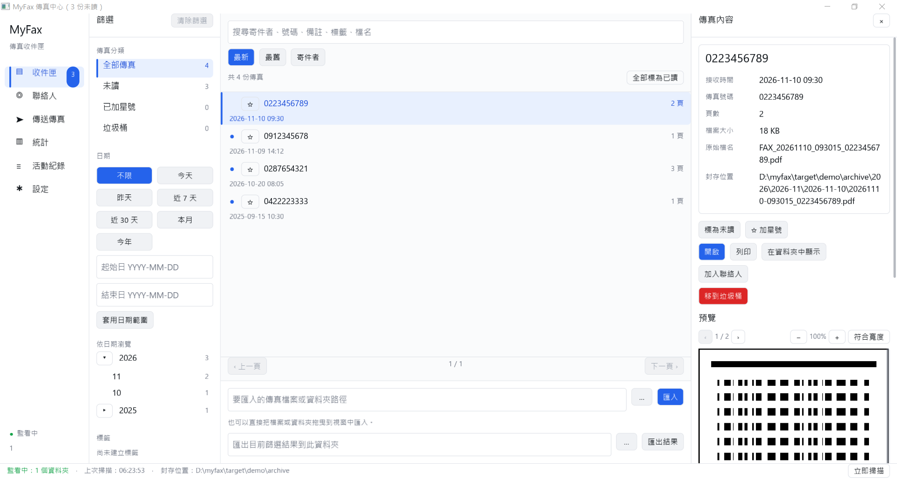

# MyFax

MyFax 是原生 Windows 傳真收件匣。它取代 Epson FAX Utility 的「接收」功能。
具傳真功能的 Epson 印表機可以把收到的傳真存成 PDF（或 TIFF）檔，放到共用的網路資料夾。
MyFax 監看這些資料夾，依日期封存每一份傳真，寫入本機 SQLite 資料庫建立索引，並在收件匣中顯示。

- MyFax **不會**直接與印表機通訊，也**不會**取代 Epson 驅動程式。
- 傳送傳真時使用已安裝的 Epson FAX 傳真驅動程式。MyFax 把文件交給驅動程式，撥號號碼由驅動程式的視窗詢問。
- MyFax 與 Epson 無關。
- 目前只在 Windows 上測試過。



其他畫面：[統計](docs/screenshots/stats-zh-TW.png)。

## 功能

- **監看資料夾**：依設定的間隔輪詢資料夾（預設 5 秒，可設 2 至 3600 秒）。檔案的大小與修改時間在兩次輪詢之間都沒有變化、檔案已存在至少 5 秒，且 PDF 結尾有 `%%EOF`（TIFF 需有正確檔頭）才會匯入；始終沒有結尾標記的檔案在連續 10 次不變後仍會匯入。因此印表機仍在寫入的檔案不會被提早匯入。
- **依日期整理的封存**：每份傳真都會複製到
  `<封存根目錄>\YYYY\YYYY-MM\YYYY-MM-DD\YYYYMMDD-HHMMSS_<寄件號碼>.pdf`。沒有寄件號碼的傳真，檔名使用 `unknown`。
- **重複偵測**：內容相同（SHA-256）的傳真會被辨識，不會重複封存。
- **檔名解析**：從檔名讀取日期、時間與寄件號碼。例如 `FAX_20261110_103045_0912345678.pdf` 會解析為 2026-11-10 10:30:45、寄件號碼 0912345678。若檔名中找不到日期，則使用檔案的修改時間。
- **收件匣**：分類包括「全部傳真」、「未讀」、「已加星號」與「垃圾桶」；日期快速篩選（不限、今天、昨天、近 7 天、近 30 天、本月、今年、自訂範圍）；依年／月／日瀏覽的日期樹；標籤篩選；依最新、最舊或寄件者排序；分頁（每頁 10 至 500 筆，預設 50 筆）。
- **搜尋**：可搜尋寄件者名稱、寄件號碼、備註、檔案名稱與標籤（部分文字比對）。
- **傳真內容**：可編輯寄件者名稱、標籤與備註。操作包括標為已讀或未讀、加星號、移到垃圾桶、還原、永久刪除（需確認）、開啟、列印、在資料夾中顯示，以及加入聯絡人。
- **頁面預覽**：可預覽 PDF 與 TIFF 頁面，支援縮放（50% 至 300%，可符合寬度）與翻頁。無法預覽的檔案，可改用預設程式開啟。
- **匯出**：把符合目前篩選條件的所有傳真（含所有頁）複製到指定資料夾。
- **拖曳與匯入**：可把檔案或資料夾拖曳到視窗中，或在收件匣輸入路徑匯入。匯入資料夾時只處理最上層的檔案。
- **聯絡人**：可新增、編輯、搜尋與刪除聯絡人。寄件者名稱會依傳真號碼對應聯絡人。支援 CSV 匯入與匯出（見下方）。
- **傳送傳真**：選擇傳真印表機、檔案與選填的收件人，並保留傳送記錄。
- **統計**：近 7 天、30 天或 1 年的總數、日均、最忙碌的一天、每日與每月長條圖，以及主要寄件者。
- **活動記錄**：「資訊」、「警告」、「錯誤」三種等級，清除時需確認。
- **自動列印**：可選擇讓透過監看資料夾收到的新傳真，自動送到預設印表機列印。
- **額外複製資料夾**：可選擇把每份新傳真另外複製一份到第二個資料夾。
- **垃圾桶保留**：超過保留天數（預設 30 天，設為 0 表示不自動清除）的垃圾桶項目，會在啟動時清除。
- **語言與主題**：繁體中文（台灣，預設）與 English；淺色與深色主題。

## 系統需求

- Windows（目前唯一測試過的平台）。
- Rust stable 工具鏈。`Cargo.toml` 設定 `rust-version = "1.88"`，使用 edition 2024。
- 建置時需要網路：AcmeUI-Native 是以 git 相依的方式引入，版本固定在 `Cargo.toml` 中的 revision。
- 接收功能：一台可把收到的傳真存到網路資料夾的 Epson 傳真印表機（見 [docs/EPSON_SETUP.md](docs/EPSON_SETUP.md)）。
- 傳送功能：電腦上已安裝 Epson FAX 傳真驅動程式。

## 快速開始

```powershell
cargo build --release
.\target\release\myfax.exe
```

發行版的執行檔位於 `target\release\myfax.exe`。

1. 開啟「設定」，在「監看資料夾」中加入印表機存檔的資料夾。
2. 按狀態列的「立即掃描」進行測試。
3. 開啟「收件匣」查看傳真。

## Epson 設定

簡要說明：在印表機上把「傳真輸出」設為「儲存到網路資料夾」（SMB），路徑指向這台電腦上的共用資料夾，檔案格式選 PDF，並把同一個資料夾加入 MyFax 的監看資料夾。
選單名稱依機型與韌體而異。完整步驟（繁體中文與英文）請見 [docs/EPSON_SETUP.md](docs/EPSON_SETUP.md)。

## 功能導覽

- **收件匣**：左欄為分類、日期篩選、日期樹與標籤；中欄為清單（上方為搜尋列，可排序、分頁與匯出）；右側為選取傳真的內容，包括資訊、操作、編輯表單與預覽。視窗標題會顯示未讀數量。
- **聯絡人**：左側為清單與搜尋，右側為編輯區。底部的 CSV 區塊可匯入與匯出聯絡人。
- **傳送傳真**：1. 選擇傳真印表機，2. 選擇檔案，3. 視需要填寫收件人與備註，然後按「傳送傳真」。名稱含有「fax」的印表機會加上標記並排在前面。安裝驅動程式後，請按「重新整理」。
- **統計**：選擇範圍（近 7 天、近 30 天、近 1 年），查看總數、圖表與主要寄件者。
- **活動記錄**：列出 MyFax 的操作紀錄，包括匯入、重複略過、列印、設定變更與錯誤。
- **設定**：語言、主題、監看資料夾、掃描間隔、封存根目錄、垃圾桶保留天數、每頁筆數，以及刪除來源檔案、接受 TIFF、自動列印、通知橫幅與額外複製資料夾等開關。

### 聯絡人 CSV 格式

- 標題列：`name,company,fax,phone,email,note`，UTF-8 編碼，欄位依 RFC 4180 規則加引號。
- 匯出時會寫入 UTF-8 BOM，讓試算表程式正確顯示中文。
- 匯入時，有無 BOM 都可以。傳真號碼與既有聯絡人相符的列，會更新該聯絡人。
- 試算表公式防護：匯出時，以 `=`、`+`、`-` 或 `@` 開頭的文字，會在前面加上單引號；匯入時會移除該引號。

## 鍵盤操作

- 在多數文字欄位按 **Enter**，會執行該欄位的主要動作，例如搜尋、匯入、新增監看資料夾或儲存聯絡人。
- 在輸入欄位中按 **Esc** 會離開該欄位；再按一次（或未在輸入欄位時）可取消確認對話框或聯絡人編輯。
- 按 **Tab** 與 **Shift+Tab** 可在按鈕、輸入欄位與可點選的列（傳真清單、分類、日期樹、左側導覽）之間切換焦點。按 **Space** 或 **Enter** 啟動。
- **Shift + 滑鼠滾輪** 可左右平移放大後的傳真預覽。
- 對話框與按鈕文字依所選語言顯示。

## 資料與備份

- 設定檔：`%APPDATA%\MyFax\settings.json`。
- 資料庫：`%APPDATA%\MyFax\myfax.db`（SQLite，使用 WAL 模式；程式執行時可能同時出現 `myfax.db-wal` 與 `myfax.db-shm`）。
- 封存的傳真：封存根目錄，預設為 `文件\MyFax Archive`。
- 設定環境變數 `MYFAX_DATA_DIR` 可改用其他資料夾（攜帶式或測試用途）。

備份時，請先關閉 MyFax，再複製 `settings.json`、`myfax.db`（連同 `-wal`、`-shm` 檔，若存在）與封存資料夾。
封存資料夾存的是實際的傳真檔；資料庫存的是索引、標籤、備註與聯絡人。

## 疑難排解

| 現象 | 可能原因 | 處理方式 |
|---|---|---|
| 出現「找不到資料夾」訊息，或狀態列顯示監看錯誤 | 監看資料夾路徑錯誤，或共用資料夾無法連線 | 在檔案總管中開啟該路徑。修正路徑或共用設定後，按「立即掃描」。 |
| 印表機已收到傳真，但 MyFax 沒有出現 | 資料夾未加入監看清單；檔案不是 `.pdf`（或是 `.tif`／`.tiff` 但未開啟 TIFF 選項）；檔案仍在寫入或為 0 位元組 | 檢查監看資料夾清單與 TIFF 開關。稍候後按「立即掃描」。 |
| 同一份傳真只出現一次，但印表機確實傳送了兩次 | 內容相同，系統判定為重複，不會再次封存 | 這是正常行為。活動記錄會顯示「略過重複的傳真」。 |
| 無法預覽 | PDF 已加密，或使用不支援的編碼（例如 JBIG2、JPEG 2000 或 LZW），或 TIFF 的非第一頁使用非 CCITT 壓縮 | 按「開啟」，用預設程式檢視。 |
| 傳真驅動程式不在印表機清單中 | 尚未安裝驅動程式，或清單過時 | 安裝 Epson FAX 驅動程式後，在「傳送傳真」頁按「重新整理」。 |
| TIFF 傳真沒有被匯入 | 「同時接受 TIFF 傳真」未開啟 | 在設定中開啟該開關。 |
| 設定沒有儲存 | 數字或路徑欄位格式不正確 | 閱讀欄位下方的提示。路徑與數字欄位需要按「儲存設定」。 |

## 建置與測試

CI（`.github/workflows/ci.yml`）在 `windows-latest` 上執行：

```powershell
cargo fmt --all -- --check
cargo clippy --locked --all-targets -- -D warnings
cargo test --locked --all-targets
cargo test --locked --doc
cargo build --locked --release
```

工作流程會把 `target/release/myfax.exe` 上傳為名為 `myfax-windows-x64` 的 artifact。

## 已知限制

- 目前只在 Windows 上測試過。
- MyFax 與 Epson 無關。
- 只讀取監看的資料夾。以電子郵件轉寄的傳真不會被抓取。
- 預覽不支援 JBIG2、JPEG 2000、LZW 與加密 PDF，會改提供「用預設程式開啟」。使用 CCITT 二維編碼（K 大於 0）的 PDF 影像也無法預覽。
- TIFF 檔除非頁面使用 CCITT 壓縮，否則只能預覽第一頁。
- 傳送無法確認對方是否收到。撥號與送達由傳真驅動程式與印表機負責。
- 注音等輸入法（IME）的編輯尚未經過人工驗證。
- QA 期間無法模擬滑鼠滾輪操作；滾輪捲動依賴框架的事件路徑。
- Epson 印表機的選單名稱依機型與韌體而異。

## 文件

- [docs/EPSON_SETUP.md](docs/EPSON_SETUP.md)：印表機設定（先繁體中文，後英文）。
- [docs/ARCHITECTURE.md](docs/ARCHITECTURE.md)：給開發者的模組架構與資料流。
- [CHANGELOG.md](CHANGELOG.md)：版本變更紀錄。

## 授權

以 [MIT](LICENSE-MIT) 或 [Apache-2.0](LICENSE-APACHE) 雙授權，由使用者擇一採用。
